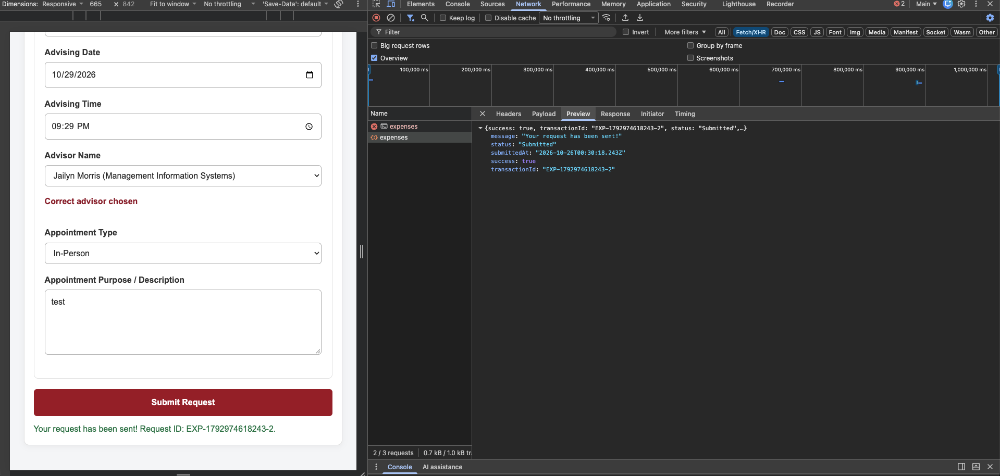
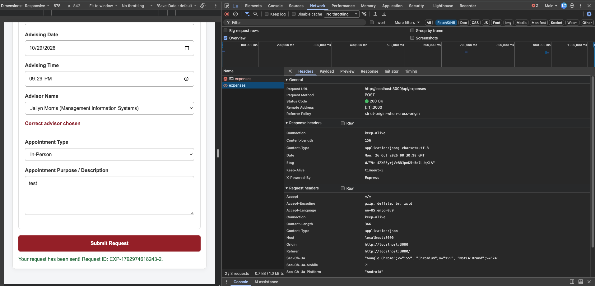
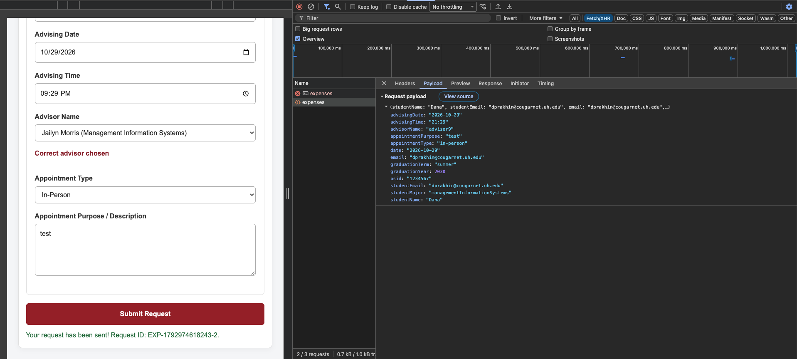
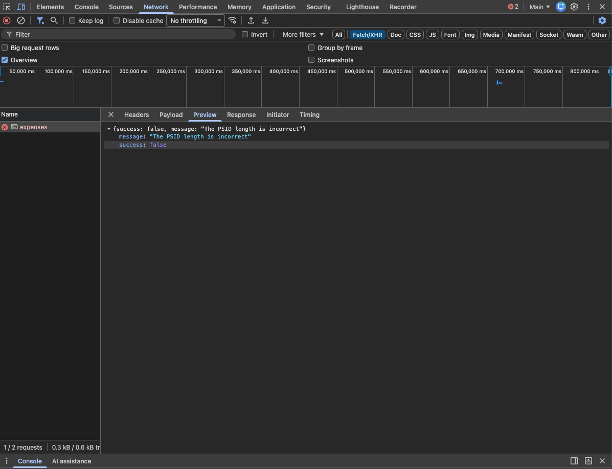
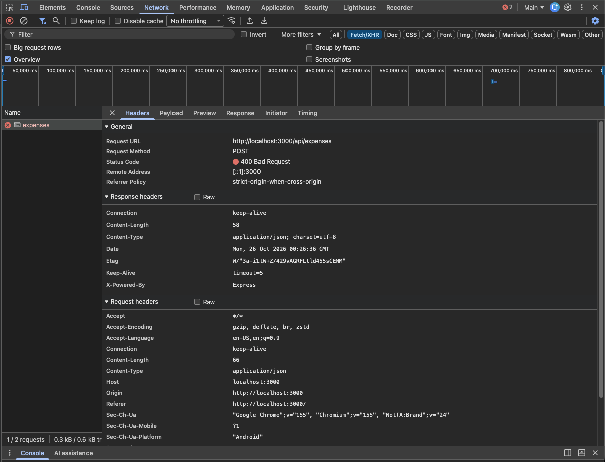
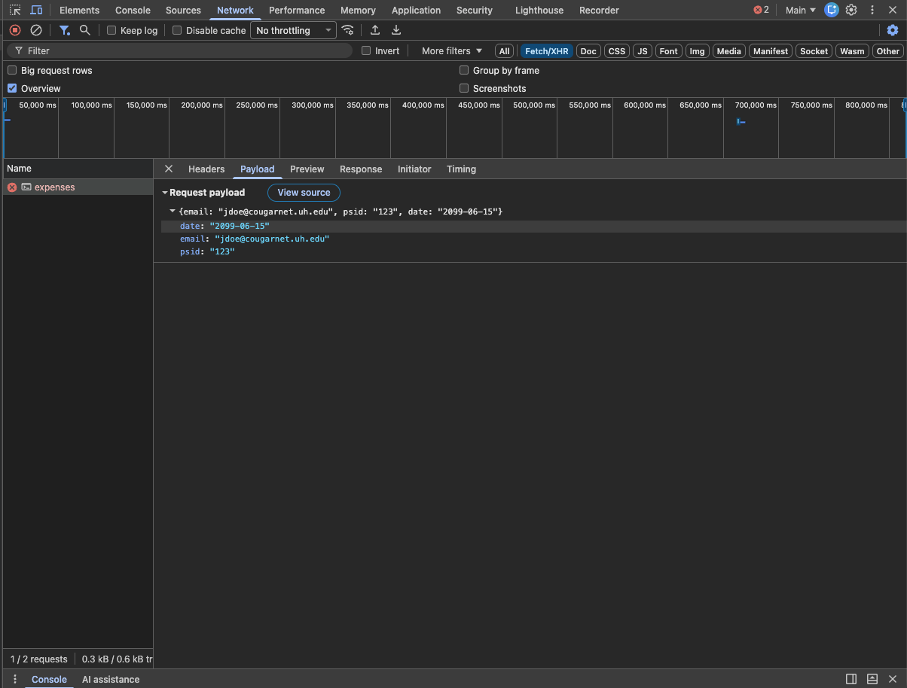
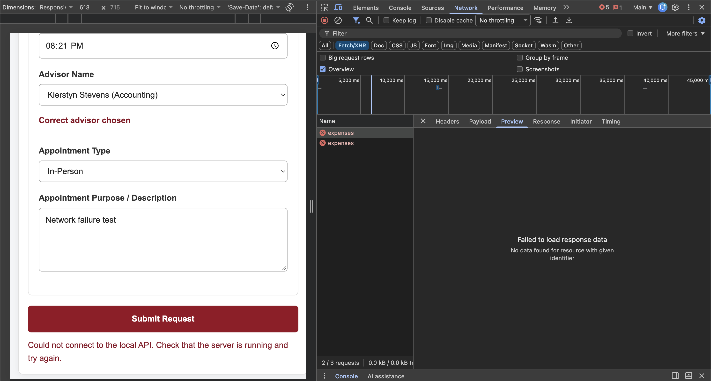
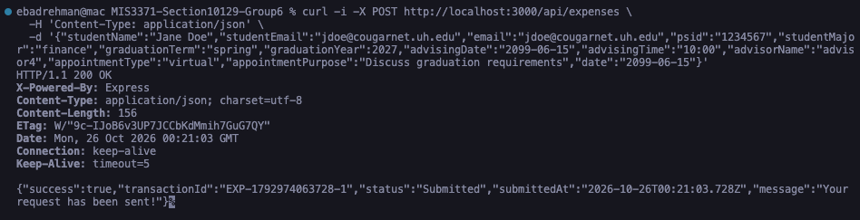
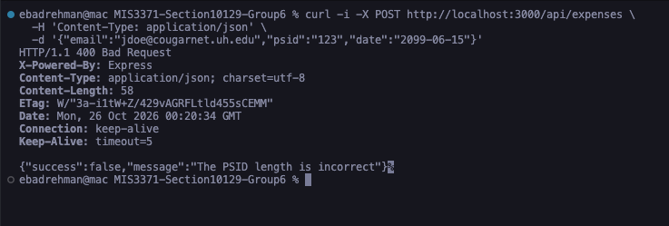
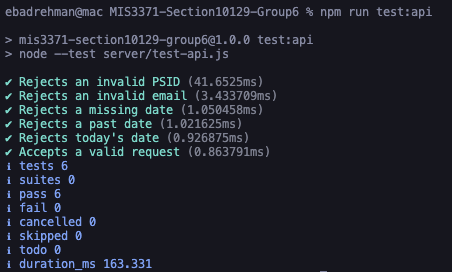

# Week 9 — Local API Evidence

## Run the application

From the repository root:

```sh
npm install
npm start
```

Open <http://localhost:3000> and submit the advising form. The browser sends
JSON to `POST /api/expenses`; the server passes the request to the Week 8
`processRequest` function and returns its JSON result.

Stop the server with `Ctrl+C`. Run the Week 9 HTTP/API tests separately:

```sh
npm run test:api
```

To run the Week 8 business-logic checks separately:

```sh
npm run test:backend
```

## Network request and response

The local server was started with `npm start` and the browser loaded
`http://localhost:3000/`. Submitting a valid advising form produced this
browser request:

- Method: `POST`
- URL: `http://localhost:3000/api/expenses`
- Request content type: `application/json`
- Response: `200 OK`, `application/json`
- Browser message: `Your request has been sent! Request ID: <generated ID>.`
- The page remained in place and the submit button was enabled after the attempt.

The generated transaction ID and timestamp vary between runs.

### Browser: successful request (HTTP 200)

The form submission is visible in Chrome DevTools Network. The screenshots show
the accepted response, request headers, and JSON payload.







Submitting a form with an invalid PSID produced this browser response:

```json
HTTP 400
{
  "success": false,
  "message": "The PSID length is incorrect"
}
```

The same backend message was displayed on the page, and the submit button was
enabled afterward. To exercise the backend rejection while keeping the form's
client-side PSID check satisfied, the browser verification altered the outgoing
request PSID to `123`.

### Browser: rejected request (HTTP 400)

The invalid-PSID JSON request was sent from the browser and rejected by the API.
The screenshots show its HTTP 400 status, request payload, and backend message.







The connection-error path was tested with the server unavailable. Since no API
response is received, this request has no HTTP status or JSON response. The page
displayed `Could not connect to the local API. Check that the server is running
and try again.` and re-enabled the button.



The following curl commands reproduce the valid and rejected endpoint responses
while the server is running.

Valid request:

```sh
curl -i -X POST http://localhost:3000/api/expenses \
  -H 'Content-Type: application/json' \
  -d '{"studentName":"Jane Doe","studentEmail":"jdoe@cougarnet.uh.edu","email":"jdoe@cougarnet.uh.edu","psid":"1234567","studentMajor":"finance","graduationTerm":"spring","graduationYear":2027,"advisingDate":"2099-06-15","advisingTime":"10:00","advisorName":"advisor4","appointmentType":"virtual","appointmentPurpose":"Discuss graduation requirements","date":"2099-06-15"}'
```

Expected status: `HTTP/1.1 200 OK`. The JSON body has `success: true`, status
`Submitted`, and message `Your request has been sent!`.



Rejected request (invalid PSID):

```sh
curl -i -X POST http://localhost:3000/api/expenses \
  -H 'Content-Type: application/json' \
  -d '{"email":"jdoe@cougarnet.uh.edu","psid":"123","date":"2099-06-15"}'
```

Expected status: `HTTP/1.1 400 Bad Request`. The JSON body has `success: false`
and message `The PSID length is incorrect`.



## Expected-versus-actual API tests

Run `npm run test:api` to execute the six Week 9 HTTP tests. They send JSON to
a temporary local Express server and compare expected HTTP status, success
value, and backend message with the actual response. The accepted case also
checks that a transaction ID and `Submitted` status are returned. The command
exits with a nonzero status if any API assertion fails. Run the original Week 8
business-logic checks independently with `npm run test:backend`.

The captured test run shows all six API tests passing:



The six cases cover:

1. PSID must contain exactly seven digits.
2. Email must use the Cougarnet domain.
3. Appointment date is required.
4. A date in the past is rejected.
5. Today's date is rejected.
6. Tomorrow's date is accepted.